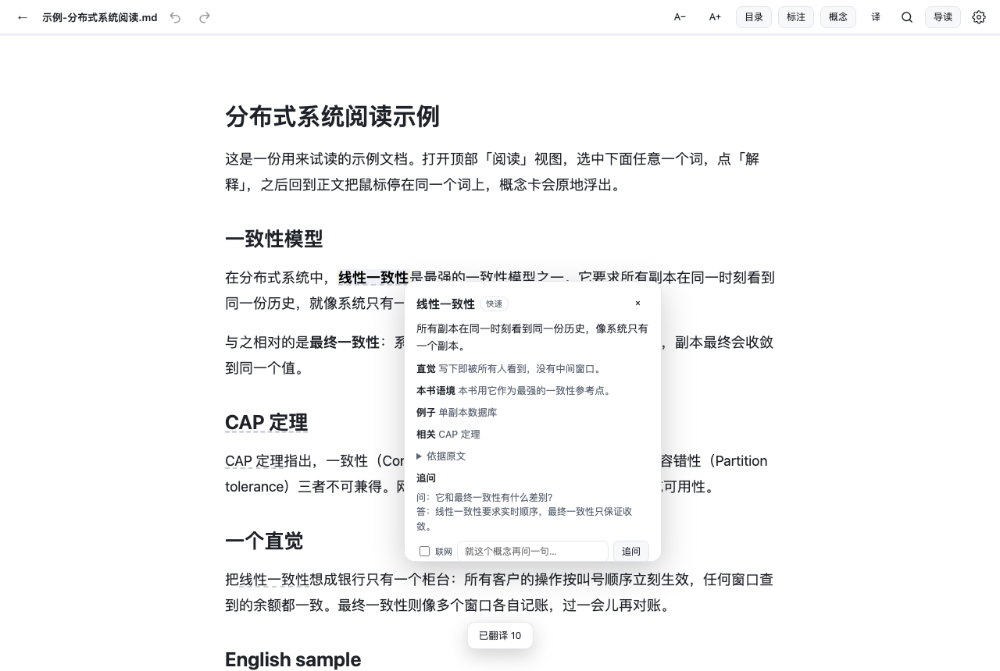
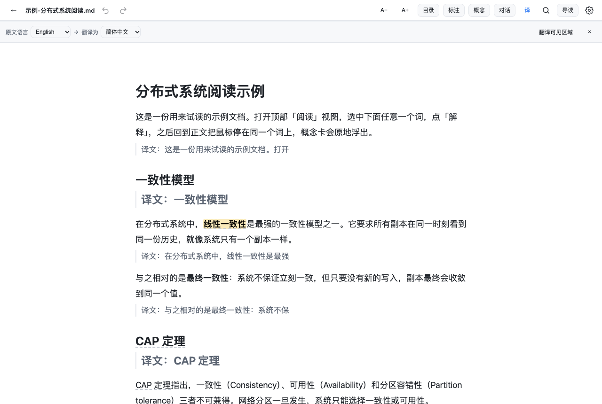

# 砚读 · DSH Reader

在 DeepSeek Harness 的工作区里读 PDF、EPUB 和 Markdown。划线、解释、导读、翻译都围绕当前这本书发生，产生的数据保存在工作区。



**当前版本：0.10.0（1.0 RC）**　·　236 项测试 / 97 项视觉检查 / 11 项发布门禁全绿

## 读一本厚书会发生什么

一本 500 页的书通常伴随几个具体问题：书签损坏、章节切分不准；内容太长，单次模型调用放不下；生成的摘要只覆盖开头；读外文时要在阅读器和翻译工具之间来回切换；标注和笔记留在某个应用里，换台机器就没了。

砚读针对这些情况做了一套阅读工作台：

- 先恢复书的结构，再按「段 → 篇 → 全书」分层生成导读；
- 概念解释沉淀成卡片，第二次遇到时直接复用，还能继续追问；
- 翻译按段落对照，PDF 用侧边译文抽屉；
- 标注、概念、导读、译文全部写入工作区的 `.dsh-reader/`，可备份、可迁移、可导出。

## 核心能力

### 1. 从真实结构出发的长书导读

PDF 优先读取内嵌书签；书签损坏时按标题字号和层级恢复章节，再退回页组。实测一本 523 页的中文书，26 条书签里 25 条指向同一页，最终恢复出 23 个章节，覆盖 3–521 页。

生成导读时按篇归约，不在一次调用里塞整本书。提供两档成本：快速档约等于篇数加一次调用，标准档按节摘要后再归约篇。每段按内容哈希缓存，内容不变时不再调用模型；生成过程显示进度，可随时停止。


### 2. 会积累的概念卡片

划词后快速解释，需要时再点「深入解释」补齐语境和例子。卡片可以编辑、合并、记录出现位置；同一概念在第二本书里复用时，追加「本书用法」，旧解释保留。

追问分三层组织：本书原文与语境、模型通识、显式开启的联网搜索。回答会标注来源层级，不确定时直接说明。

### 3. 按段的翻译

Markdown 和 EPUB 支持「关 / 段落对照 / 仅译文」三态；PDF 使用右侧译文抽屉，按页翻译文本块；选中一段文字也可以即时翻译。译文按段落哈希缓存，同一段不重复计费。



### 4. 不打断阅读的标注与浮窗

高亮、笔记、撤销/重做都留在正文上方；概念卡、标注编辑器、译文卡按阅读区边界定位，优先出现在文字侧边，窄屏自动收缩。键盘可以完成打开书、切换抽屉、激活术语与高亮等操作，方向键和 Home/End 负责滚动与首尾。

### 5. 数据归你

文档以内容指纹（文件大小 + 首尾 4KB 的 SHA-256）为主键，改名、移动不会丢标注；原文变化时提示并支持迁移。写入队列避免并发覆盖，自动保留最近 5 份备份，损坏时回退到最新可读版本。支持 JSON 导入导出和标注 Markdown 导出。

### 6. 可回归的质量门禁

| 门禁 | 内容 | 数量 |
| --- | --- | --- |
| 单元 / DOM | store、迁移、锚点、guide/translate 解析、键盘流程、死线 | 236 |
| 产品 eval | 解析、渲染、锚点、性能、bundle 冒烟 | 10 |
| 视觉回归 | 无头 Chrome + 像素基线 + 真实鼠标交互 | 97 |
| 宿主布局 | 真实 DSH CSS 链 + 真实 client.js | 6 |
| 发布检查 | 迁移演练、导出回环、资产、文档 | 11 |

真书 dogfood 覆盖了 523 页 PDF 和 27 章 EPUB 的渲染、目录、翻译、快速导读与导图。

## 一次阅读会话

| 步骤 | 操作 |
| --- | --- |
| 打开 | 书库选择文件；PDF 先出页面，目录在后台分析 |
| 划线 | 选词浮出工具条：解释、翻译、笔记、高亮、复制 |
| 理解 | 快速概念卡；需要时深入解释或追问 |
| 读整本 | 快速或标准导读；导图可全屏、缩放、展开到分片 |
| 外文 | 段落对照、仅译文或 PDF 译文抽屉 |
| 收尾 | 标注 Markdown、导图 SVG/PNG/MD、JSON 备份与迁移 |


## 适合与不适合

适合：读技术书、行业报告、外文非虚构，希望边读边留下可复用笔记的人；需要快速拆出厚书章节骨架的人；在意数据归属、希望标注跟着文件走的人。

不适合：扫描版 PDF（没有文本层，无法划词）；固定版式 EPUB（FXL）；主要使用手机阅读的人。

## 安装

前置：DSH 桌面版。

```bash
# 在 DSH Web GUI 的插件页添加本地目录 dsh-reader/
# 或由 agent 调用 plugin_manager，target 为本仓库 dsh-reader/ 的绝对路径
```

安装后刷新页面，在会话顶部切换到「阅读」。仓库自带 Markdown、EPUB、PDF 三份示例书。

## 数据与隐私

- 阅读数据保存在当前工作区的 `.dsh-reader/`，用于本地读写，无遥测；
- 解释、导读、追问、翻译调用 DSH 中配置的模型；联网搜索只在追问时显式开启；
- 设置页可以查看最近 10 次发送给模型的内容摘要；
- 数据支持导出、导入、备份恢复和删除。

## 开发

```bash
cd dsh-reader
pnpm install
pnpm build            # 生成 client.js
pnpm test             # 236 条单元/DOM 测试
pnpm eval             # 10 项产品级 eval
pnpm eval:visual      # 97 项视觉检查（需要 DSH GUI + Chrome）
pnpm release:check    # 11 项发布门禁
```

技术细节见 [亮点与技术设计](docs/亮点与技术设计.md)。

## 项目结构

```text
docs/              PRD、开发手册、发布说明、验收清单、设计说明
dsh-reader/        插件本体
  index.js         Host 路由（store / explain / guide / translate / ask）
  lib/             store、迁移、提示词、guide/translate 解析、调用死线
  src/client/      阅读器界面（React，构建为 client.js）
  test/            单元 / DOM 测试
  eval/            产品 eval、视觉基线、宿主布局探针
  scripts/         构建、迁移演练、视觉与发布门禁
```

## 已知限制

- 扫描版 PDF 没有文本层，不能划词标注；固定版式 EPUB（FXL）不支持；
- PDF 章节恢复使用排版启发式，书签损坏时章节边界可能与原书目录有差异；
- 快速导读按篇采样，每篇取头尾代表性文本，不保证每个小节都进入摘要；
- 「仅译文」模式不能划词标注，会提示切回段落对照；
- 段落对照翻译不翻译代码块；PDF 译文按页文本块，图注也会被翻译；
- 移动端未适配，阅读区按 DSH 主区域布局。

## 文档

- [亮点与技术设计](docs/亮点与技术设计.md)
- [1.0 需求与决策](docs/PRD-v1.0-阅读工作台.md)
- [1.0 开发手册](docs/1.0-开发手册.md)
- [1.0 发布说明](docs/1.0-发布说明.md)
- [1.0 验收清单](docs/1.0-验收清单.md)
- [DoD 对照表](docs/1.0-DoD-对照表.md)

## English

DSH Reader is a reading workspace plugin for DeepSeek Harness. It opens PDF, EPUB and Markdown files from the session workspace, keeps highlights and notes as durable data, explains concepts with reusable cards, builds structure-aware guides and mind maps for long books, and supports paragraph-aligned translation. All reading data stays in the workspace `.dsh-reader/` store; model calls use the provider configured in DSH. Status: 1.0 release candidate (plugin 0.10.0).

## License

[MIT](LICENSE)
