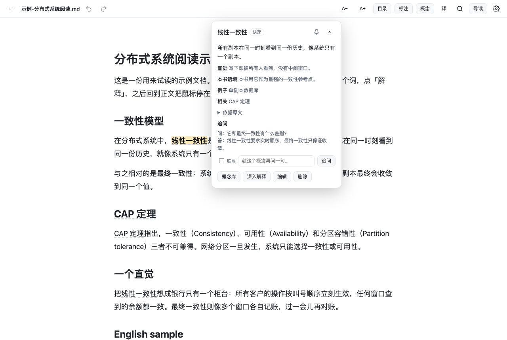
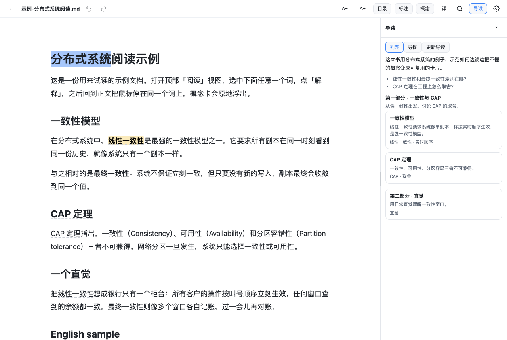

# 砚读 · DSH Reader

在 DeepSeek Harness 的工作区里读 PDF、EPUB 和 Markdown。主要用在论文、技术文档、新领域入门和系统学习：阅读保持连续，遇到问题在原文处解决，解释和笔记沉淀成可以再次使用的概念卡。




## 一个设计目标：让阅读保持连续

读一本难书时，打断阅读的时刻通常来自解决问题的方式：遇到一个词，切到聊天窗口提问；得到一个回答，再切回来；读到下一段，发现还需要补充，于是又开一个会话。人回来了，上下文已经散了。

砚读围绕一个目标设计：**阅读保持连续，问题在原位解决，解决结果留在书里。**

由此形成四条产品原则：

1. **阅读优先**：浮窗贴着选区出现，键盘和滚动仍由正文掌握；选词、翻页、关闭浮层的路径保持连贯。
2. **原文处解决**：选词后直接出现解释、翻译和笔记工具；概念卡、追问、父子概念都从当前词附近的原文出发。
3. **结果可沉淀**：解释自动保存为概念卡，记录出现位置；下次遇到同一概念直接复用，跨书也能累积“本书用法”。
4. **导航放在阅读旁边**：目录、搜索、导读和导图以侧栏或全屏浮层展开，阅读器始终停留在当前段落。

## 核心功能：概念卡

概念卡是这套设计的中心。它同时承担解释、追问、关联和记忆。

### 划词即解释

选中任意词或短语，工具条提供解释、翻译、笔记、高亮和复制。快速解释返回定义、直觉和例子；需要更完整的语境时，点「深入解释」补齐。解释在卡片里完成，卡片出现在选中文字旁边，正文停留原位。

### 卡片会留下来

解释成功后，概念自动写入当前工作区的概念库：

- 记录**出现位置**，点一下就能回到原文；
- 卡片可以固定、独立拖动、编辑、合并；叠加时每张卡单独响应指针。
- 同一概念在第二本书里再次遇到时，追加「本书用法」，原有解释保留；
- 概念库支持按本书/全部筛选，也可以从卡片直接定位。

### 问题可以继续往下拆

追问按三层组织：本书原文与语境、模型通识、显式开启的联网搜索。回答会标注来源层级。一个解释里遇到的新概念，可以继续生成子卡片，形成概念链；卡片上会显示当前链路上的父子关系。

概念卡支持边读边问：读到哪、问到哪里，卡片就长到哪里。

## 阅读的其他环节

概念卡之外，阅读本身需要标注、导航和翻译。

### 标注与笔记

四色高亮、笔记、撤销/重做；跨粗体、代码的高亮会按段拆开；原文变化导致锚点失效时会给出提示。标注和概念一样写入工作区，随文件保留。

### 导读与思维导图

长书先恢复结构，再生成导读：

- PDF 优先读取内嵌书签，书签损坏时按标题字号和层级恢复章节；
- 按「段 → 篇 → 全书」分层归约，提供快速和标准两档成本；
- 思维导图默认展开到章级，点击展开分片；支持缩放、拖拽、全屏和导出；
- 点击导图节点可以查看该章摘要、要点，并跳回原文。


### 翻译

默认英译中，原文语言和目标语言都可以选择。Markdown 和 EPUB 只翻译当前可见段落，滚动时继续补齐；PDF 译文抽屉按批返回，译文边看边补。代码块保留原文。


### 搜索与定位

当前书籍的全文搜索、标注列表、概念列表都放在侧栏。侧栏可以拖动左边界调整宽度、双击恢复默认；目录/标注/概念/导读/设置共用这套交互，导读列表和导图分别记忆宽度与滚动位置。

## 用在这些场景

### 论文与研究报告

一篇论文的难点往往集中在几个术语和一段背景上。选中摘要或正文里的术语，解释卡会出现在原位置；卡片记录出处，之后回到那一页仍然能找到。读下一篇论文时，同一个概念会追加「本书用法」，对比不同论文的定义差异。

英文论文可以开段落对照或仅译文，按当前视口翻译，滚动时继续补。划词依赖文本层：公式区域和扫描版 PDF 暂时无法选中；有文本层的论文可以正常解释与翻译。

### 技术文档与规范

读框架、API、协议文档时，常遇到「这个词在这里具体指什么」。术语解释、代码块旁的说明、高亮和笔记都留在文档上；翻译时代码块保持原文，避免标识符被改写。全文搜索、目录和侧栏定位用于在长文档里来回跳转。

### 进入一个新领域

先用导读建立章节骨架，再用导图看篇/章关系；读到不懂的词，生成概念卡，遇到派生词继续生成子卡，形成一条概念链。概念库可以按当前书或全部查看，把散落在各章的术语收成一张领域地图。

适合主题阅读：同一领域的几本书可以各自保留「本书用法」，概念卡在书之间复用。

### 系统学习与长期积累

概念卡可以长期维护：记录定义、直觉、语境、例子和出处，随时编辑、合并，也可以导出为 Markdown 或 JSON。标注同样可以导出，换设备或换工作区时带走。

课程材料、行业报告、技术书都适合用这套流程：读的时候解决问题，读完留下可检索的概念和标注。

## 一次阅读会话

| 步骤 | 会看到什么 |
| --- | --- |
| 打开 | 书库选择文件；PDF 先出页面，目录在后台分析 |
| 划线 | 工具条浮在选区旁：解释、翻译、笔记、高亮、复制 |
| 理解 | 快速概念卡；需要时深入解释或追问 |
| 深挖 | 解释中的新词生成子卡片；卡片记录出处 |
| 读整本 | 导读和导图提供章节骨架，可跳回原文 |
| 外文 | 段落对照、仅译文或 PDF 译文抽屉，按可见区域渐进 |
| 收尾 | 概念库、标注 Markdown、导图导出、JSON 备份 |



## 共同点

这些场景都要求阅读保持连续：问题在原文旁解决，结果留在书里，下一次还能找到。

**暂未覆盖**：扫描版 PDF（没有文本层，无法划词）、固定版式 EPUB（FXL）、手机端阅读。

## 安装

前置：DSH 桌面版。

```bash
# 在 DSH Web GUI 的插件页添加本地目录 dsh-reader/
# 或由 agent 调用 plugin_manager，target 为本仓库 dsh-reader/ 的绝对路径
```

安装后刷新页面，在会话顶部切换到「阅读」。仓库自带 Markdown、EPUB、PDF 三份示例书。

## 数据与隐私

- 标注、概念、导读、译文保存在当前工作区 `.dsh-reader/store.json`，无遥测；
- 文档以内容指纹为主键，改名、移动后标注仍然有效；
- 写入前自动备份最近 5 份，支持恢复；v1 数据自动迁移；
- JSON 导入导出、标注 Markdown 导出；
- 解释、导读、追问、翻译使用 DSH 中配置的模型；联网搜索只在追问时显式开启。

## 开发与验证

```bash
cd dsh-reader
pnpm install
pnpm build            # 生成 client.js
pnpm test             # 259 条单元/DOM 测试
pnpm eval             # 13 项产品级 eval
pnpm eval:visual      # 136 项视觉检查（需要 DSH GUI + Chrome）
pnpm release:check    # 11 项发布门禁
```

| 门禁 | 数量 |
| --- | --- |
| 单元 / DOM 测试 | 259 |
| 产品级 eval | 13 |
| 视觉回归（无头 Chrome + 真实鼠标交互） | 136 |
| 宿主布局探针 | 6 |
| 发布检查（迁移、导出回环、资产、文档） | 11 |

真书 dogfood 覆盖 523 页 PDF 与 27 章 EPUB 的渲染、目录、翻译、快速导读和导图。

## 项目结构

```text
docs/              PRD、开发手册、发布说明、验收清单、设计说明
dsh-reader/        插件本体
  index.js         Host 路由（store / explain / guide / translate / ask）
  lib/             store、迁移、提示词、guide/translate 解析、调用死线
  src/client/      阅读器界面（React，构建为 client.js）
  test/            单元 / DOM 测试
  eval/            产品 eval、视觉基线、宿主布局探针
  scripts/         构建、迁移演练、视觉与发布门禁
```

## 已知限制

- 划词依赖文本层：扫描版 PDF 和固定版式 EPUB（FXL）暂不支持；
- PDF 章节恢复使用排版启发式，书签损坏时章节边界可能与原书目录有差异；
- 快速导读按篇采样，每篇取头尾代表性文本，部分小节可能省略；
- 「仅译文」模式用于译文阅读；需要划词时请切回段落对照；
- 段落对照翻译保留代码块原文；PDF 译文按页文本块，图注也会被翻译；
- 移动端未适配，阅读区按 DSH 主区域布局。

## 文档

- [设计说明](docs/亮点与技术设计.md)
- [1.0 需求与决策](docs/PRD-v1.0-阅读工作台.md)
- [1.0 开发手册](docs/1.0-开发手册.md)
- [1.0 发布说明](docs/1.0-发布说明.md)
- [1.0 验收清单](docs/1.0-验收清单.md)
- [DoD 对照表](docs/1.0-DoD-对照表.md)

## English

DSH Reader is a reading workspace plugin for DeepSeek Harness, built for papers, technical documentation and learning a new field. It keeps reading continuous: select a term to get an in-place explanation, follow up without leaving the page, and keep the result as a reusable concept card anchored to the source text. PDF, EPUB and Markdown reading, structure-aware guides, mind maps and visible-first translation are built around that workflow. Reading data stays in the workspace `.dsh-reader/` store. Status: 1.0 release candidate (plugin 0.11.2).

## License

[MIT](LICENSE)
