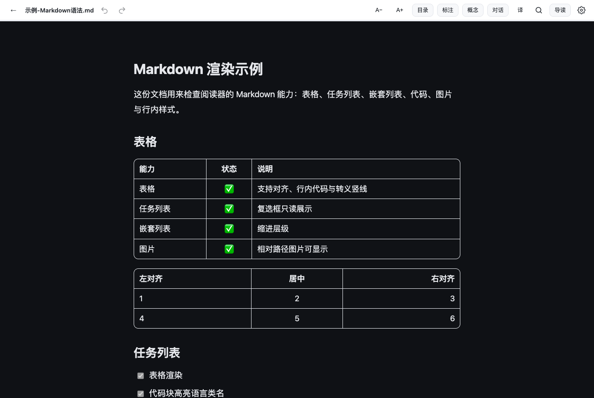

# 砚读 · DSH Reader

**在 DeepSeek Harness 里，把「读完一本厚书」变成一套可标注、可追问、可沉淀、可迁移的工作流。**


> 不是又一个 PDF 阅读器，也不是聊天框里的“帮我总结这本书”。砚读把阅读过程本身做成数据资产：你划过的线、问过的问题、模型给过的解释、最后生成的全书骨架，都留在你的工作区里。




## 六个亮点

### 1. 厚书真的读得完：结构感知的分层导读

普通渲染器只会把 PDF 按页翻；砚读会先理解这本书的**结构**：

- PDF 优先读内嵌书签；书签坏了（实测一本 523 页中文书，26 条书签里 25 条指向同一页）就按**标题字号 + 层级**恢复章节，再不行退回页组；
- 按「段 → 篇 → 全书」两层归约，而不是一次塞给模型；
- 两种成本档：**快速（篇级）**与**标准（段+篇）**。同一本 27 章的书，快速档约 **27 次模型调用**，标准档约 73 次；
- 每段按内容哈希缓存，内容没变就 **0 次调用**；生成过程可见进度、可随时停止。

实测：523 页 PDF 恢复 **23 个章节**，首屏 **0.2s** 绘出（目录在后台分析）；快速导读 **24 篇 / 67.2s** 完成并入库。


### 2. 概念不是一次性问答，而是会留下来的卡片

- 划词 → 快速解释（约 2.4s）→ 需要时点「深入解释」补齐语境/例子；
- 卡片可编辑、可合并、可记录**出现位置**，点一下就能跳回原文；
- 同一概念在第二本书里复用时，追加「本书用法」而不是覆盖旧解释；
- 父子卡片可以层层嵌套，读完一章，概念之间已经形成关系。

### 3. 追问允许“超出这本书”

回答按三层组织：

1. **本书资料**：概念定义、原文、本书语境；
2. **模型通识**：书里没展开但模型内化的知识，会标注来源层级；
3. **联网搜索**：追问时显式勾选「联网」，才调用 DSH 的 `web` 服务，答案带来源链接，搜索失败自动降级。

不编造、不确定就说不确定——这是产品约束，不是提示词彩蛋。

### 4. 翻译长在阅读流程里，而不是另一个页面

- Markdown / EPUB：工具栏「译」三态循环 **关 → 段落对照 → 仅译文**；
- PDF：右侧译文抽屉，按当前页文本块对照，「翻译本页」按需执行；
- 选中一段文字可即时翻译，浮小卡片，不打断阅读；
- 译文按段落哈希缓存。实测：6 段首次 **6.27s**，再次 **0.01s** 全命中；PDF 一页 8 块首次 **2.07s**，缓存 **0.01s**。


### 5. 数据是你的，不是平台的

- 标注、概念、导读、译文全部保存在**当前工作区** `.dsh-reader/store.json`，不上传；
- 文档以**内容指纹**为主键——改名、移动不丢标注；原文改动会提示并支持一键迁移旧标注；
- 写前自动备份最近 5 份，可一键恢复；v1 数据自动迁移；
- JSON 导入导出、标注 Markdown 导出，换机器不丢资产；
- 设置里能看到最近 10 次发给模型的内容摘要。

### 6. 质量是可验证的，不是“感觉还行”

| 门禁 | 数量 |
|---|---|
| 单元 / DOM 测试 | **236** |
| 产品级 eval | **10** |
| 视觉回归（无头 Chrome + 像素基线 + 中英文界面） | **88** |
| 发布检查（迁移演练 / 导出回环 / 资产 / 文档） | **10** |

真书 dogfood 也进了流程：523 页 PDF 与 27 章 EPUB 的渲染、目录、翻译、快速导读都用真实数据跑过。CI 在 Ubuntu 上跑 `test + eval`，每次 push 自动验证。

## 一次完整的阅读工作流

| 步骤 | 你会看到 |
|---|---|
| 打开 | 书库 → 阅读视图；PDF 先出页面，目录后台就绪 |
| 划线 | 选词浮出工具条：解释 / 翻译 / 笔记 / 四色高亮 / 复制 |
| 理解 | 快速概念卡，需要时「深入解释」，再追问 |
| 读整本 | 快速或标准导读，篇/段进度可见，可停止 |
| 外文 | 段落对照或仅译文；PDF 译文抽屉 |
| 收尾 | 导图导出、标注 Markdown、JSON 备份/迁移 |


## 适合谁

- 读技术书、行业报告、外文非虚构，希望**边读边留下可复用笔记**的人；
- 需要把一本厚书快速拆成**章节骨架与核心问题**的人；
- 在意数据归属、希望标注能跟着文件走而不是锁在某个 App 里的人；
- 想在 DSH 里把阅读、提问、写作串成一条工作流的人。

**不适合**：只需要看扫描版 PDF 的人（无文本层不能标注）；需要固定版式 EPUB 的人；期待手机端体验的人（当前只面向 DSH 桌面阅读区）。

## 安装

前置：DSH 桌面版。

```bash
# 在 DSH Web GUI 的插件页添加本地目录 dsh-reader/
# 或由 agent 调用 plugin_manager，target 为本仓库 dsh-reader/ 的绝对路径
```

安装后刷新页面，在任意会话顶部切换到「阅读」。仓库自带三份示例书（Markdown / EPUB / PDF），装完即可试。

## 数据与隐私

- 阅读数据保存在**当前工作区**的 `.dsh-reader/`，不联网存储、无遥测；
- 解释、导读、追问、翻译使用你在 DSH 中配置的模型；联网搜索只在追问里显式开启；
- 全部数据可导出、可迁移、可删除；备份与恢复在设置里。

## 开发

```bash
cd dsh-reader
pnpm install
pnpm build            # 生成 client.js
pnpm test             # 236 条单元/DOM 测试
pnpm eval             # 10 项产品级 eval
pnpm eval:visual      # 95 项视觉检查（需要 DSH GUI + Chrome）
pnpm release:check    # 11 项发布门禁
```

设计细节（结构恢复、分层归约、缓存与并发、视觉门禁）见 **[docs/亮点与技术设计.md](docs/亮点与技术设计.md)**。

## 项目结构

```
docs/              PRD、开发手册、发布说明、验收清单、亮点与设计
dsh-reader/        插件本体
  index.js         Host 路由（store / explain / guide / translate / ask）
  lib/             store、迁移、提示词、guide/translate 解析
  src/client/      阅读器界面（React，构建为 client.js）
  test/            单元 / DOM 测试
  eval/            产品 eval + 视觉基线
  scripts/         构建、迁移演练、视觉与发布门禁
```

## 已知限制

- 扫描版 PDF 无文本层，不能划词标注；固定版式 EPUB（FXL）不支持；
- PDF 章节恢复是排版启发式：书签损坏时按标题字号识别，章节边界可能与原书目录不完全一致；
- 快速导读按篇采样（每篇取头尾代表性文本），不保证每个小节都进入摘要；
- 「仅译文」模式不能划词标注（会提示切回段落对照）；
- 段落对照翻译不翻译代码块；PDF 译文按页文本块，图注也会被翻译；
- 移动端未适配。

## 文档

- [亮点与技术设计](docs/亮点与技术设计.md)
- [1.0 需求与决策](docs/PRD-v1.0-阅读工作台.md)
- [1.0 开发手册](docs/1.0-开发手册.md)
- [1.0 发布说明](docs/1.0-发布说明.md)
- [1.0 验收清单](docs/1.0-验收清单.md)
- [DoD 对照表](docs/1.0-DoD-对照表.md)

## English

DSH Reader is a reading workspace plugin for DeepSeek Harness. It opens PDF / EPUB / Markdown from the session workspace, keeps highlights and notes as durable data, explains concepts with nested cards, builds structure-aware guides and mind maps for long books, and lets you read foreign-language material with paragraph-aligned translation. Everything stays in the workspace `.dsh-reader/` store; model calls use the provider configured in DSH. Current status: **1.0 RC**.

## License

[MIT](LICENSE)
