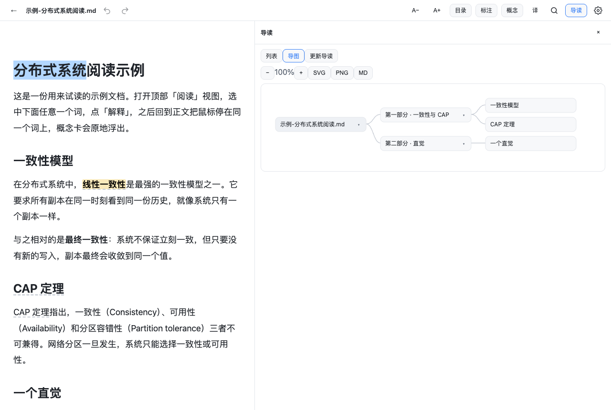

# 砚读 · DSH Reader

在 DeepSeek Harness（DSH）里工作的阅读台：读工作区里的 PDF / EPUB / Markdown，划词标注，让模型把不懂的概念解释并沉淀成卡片，读完整本书生成分层导读与思维导图，支持段落级双语翻译。

> 状态：**1.0 Release Candidate**。代码侧门禁全绿：204 条测试 / 10 项 eval / 68 项视觉检查 / 10 项发布检查。


## 功能

- **阅读**：PDF（文本层、缩放、双页）、EPUB（目录、内链）、Markdown/TXT；浅色/深色/米黄主题，字号行距记忆。
- **标注**：四色高亮、笔记、撤销/重做；跨粗体/代码的高亮逐段包裹；锚点失效可见提示。
- **概念**：划词解释（快速 / 深入两档 + 缓存 + 同词并发去重）、父子卡层叠、悬停卡、出现位置与跨文档跳转、概念合并、本书用法补充、追问（本书资料 + 模型通识 + 可选联网搜索）。
- **导读**：结构感知的长书导读——PDF 优先真实书签、坏书签按排版恢复章节；EPUB/Markdown 按章节/标题；「快速（篇级）」与「标准（段+篇）」两档成本；进度可停止、增量缓存；思维导图（书 → 篇 → 节）与 SVG/PNG/Markdown 导出。
- **翻译**：Markdown/EPUB「关 / 段落对照 / 仅译文」三态；PDF 右侧译文抽屉按页对照；划词即时翻译；目标语言可选；按段缓存。
- **数据**：工作区 `.dsh-reader/store.json`（v2，内容指纹主键、v1 自动迁移、5 份备份、一键恢复）；JSON 导入导出、标注 Markdown 导出。
- **体验**：⌘F 全文搜索、键盘可达（书库/抽屉/术语/高亮可聚焦，Enter 激活）、中英双语界面、错误边界可复制诊断信息、最近发送内容可查。



## 安装

前置：DSH 桌面版（本插件面向 DSH 的 Host/Client 插件体系）。

```bash
# 方式一：在 DSH Web GUI 的插件页添加本地目录 dsh-reader/
# 方式二：由 agent 调用 plugin_manager，target 为本仓库 dsh-reader/ 的绝对路径
```

安装后在任意会话顶部切换到「阅读」视图。仓库根目录自带三份试读素材（示例 Markdown / EPUB / PDF）。

## 数据与隐私

- 标注、概念、导读、译文都保存在**当前工作区**的 `.dsh-reader/` 下；不联网存储。
- 解释 / 导读 / 追问 / 翻译会调用你在 DSH 中配置的模型；联网搜索只在追问里显式勾选「联网」时触发。
- 设置页可查看最近 10 次发送给模型的内容摘要。

## 开发

```bash
cd dsh-reader
pnpm install
pnpm build            # 生成 client.js
pnpm test             # 204 条单元/DOM 测试
pnpm eval             # 10 项产品级 eval
pnpm eval:visual      # 68 项视觉检查（无头 Chrome，需要 GUI 与 Chrome）
pnpm release:check    # 10 项发布门禁（含视觉、迁移演练、导出回环）
```

> `eval:visual` 与 `release:check` 会启动无头 Chrome，并需要一个运行中的 DSH GUI（默认 `127.0.0.1:60592`）来提供真实文件路由；CI 只跑 `test` + `eval`。

## 项目结构

```
docs/              PRD、1.0 开发手册、发布说明、验收清单
dsh-reader/        插件本体
  index.js         Host 路由（store/explain/guide/translate/ask…）
  lib/             store、迁移、提示词、guide/translate 解析
  src/client/      阅读器界面（React，构建为 client.js）
  test/            单元 / DOM 测试
  eval/            产品 eval + 视觉基线
  scripts/         构建、迁移演练、视觉/发布门禁
```

## 已知限制

- 扫描版 PDF 无文本层，不能划词标注；固定版式 EPUB（FXL）不支持。
- 固定格式 PDF 的章节恢复是排版启发式：书签损坏时会按标题字号识别，章节边界可能与原书目录不完全一致。
- 段落对照翻译在「仅译文」模式下不能划词标注（会提示切回对照）。
- 段落对照翻译不会翻译代码块；PDF 译文按页文本块，图注也会被翻译。
- 移动端未适配；阅读区按 DSH 主区域布局。

## 文档

- [1.0 需求与决策](docs/PRD-v1.0-阅读工作台.md)
- [1.0 开发手册](docs/1.0-开发手册.md)
- [1.0 发布说明](docs/1.0-发布说明.md)
- [1.0 验收清单](docs/1.0-验收清单.md)
- [DoD 对照表](docs/1.0-DoD-对照表.md)

## English

DSH Reader is a reading workspace plugin for DeepSeek Harness: open PDF/EPUB/Markdown from the session workspace, highlight and annotate, explain concepts with cards, generate structure-aware guides and mind maps, and read with paragraph-aligned translation (Markdown/EPUB inline, PDF in a side drawer). All reading data stays in the workspace `.dsh-reader/` store; model calls use the provider configured in DSH.

## License

[MIT](LICENSE)
