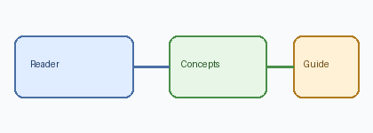

# Markdown 渲染示例

这份文档用来检查阅读器的 Markdown 能力：表格、任务列表、嵌套列表、代码、图片与行内样式。

## 表格

| 能力 | 状态 | 说明 |
| --- | :---: | --- |
| 表格 | ✅ | 支持对齐、行内代码与转义竖线 |
| 任务列表 | ✅ | 复选框只读展示 |
| 嵌套列表 | ✅ | 缩进层级 |
| 图片 | ✅ | 相对路径图片可显示 |

| 左对齐 | 居中 | 右对齐 |
| :--- | :---: | ---: |
| 1 | 2 | 3 |
| 4 | 5 | 6 |

## 任务列表

- [x] 表格渲染
- [x] 代码块高亮语言类名
- [ ] 脚注（暂不支持）

## 嵌套列表

- 第一层
  - 第二层
    - 第三层
- 另一个第一层
  1. 有序子项
  2. 有序子项二

## 代码

```js
const reader = createReader({ tables: true })
console.log(reader.render('| a | b |'))
```

~~~
这是波浪线围栏，同样按代码块渲染。
~~~

## 图片



## 行内样式

**加粗**、*斜体*、~~删除线~~、`inline <code>`，以及 [外部链接](https://example.com)。
